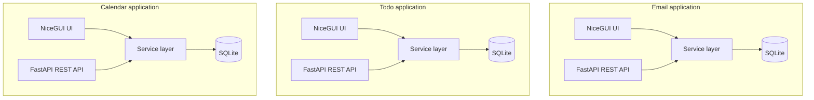
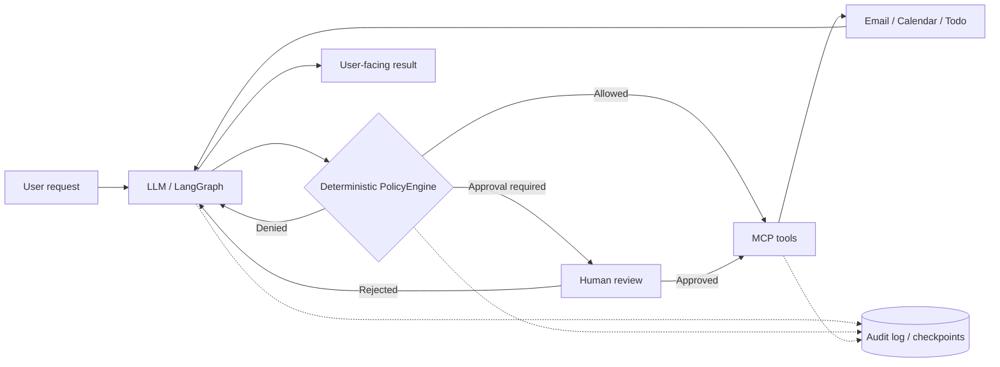

# MCP & AI Agent Training

Three working applications (Email, Todo, and Calendar), each with its own UI, REST API, and database. Your job is to connect them to [MCP](https://modelcontextprotocol.io/), build an agent on top, and decide how to keep that agent's actions safe and traceable. When you're done, compare your solution with the reference implementations.

Everything runs locally. The project covers MCP integration patterns, [LangGraph](https://www.langchain.com/langgraph), agent orchestration, and safety controls.

> **The `main` branch has no MCP servers and no agent.** That's where you start. Working reference implementations live in the [`MCP`](https://github.com/Dreablin/MCP_Agent_Training/tree/MCP) and [`Agent`](https://github.com/Dreablin/MCP_Agent_Training/tree/Agent) branches.

## Stages

| Stage | Branch | What's there | What you do |
| --- | --- | --- | --- |
| 1. Working apps | [`main`](https://github.com/Dreablin/MCP_Agent_Training/tree/main) | Three independent apps with UIs, REST APIs, and SQLite databases | Add MCP access to the existing apps |
| 2. MCP architecture | [`MCP`](https://github.com/Dreablin/MCP_Agent_Training/tree/MCP) | Reference MCP integrations built three different ways | Compare transports, process boundaries, API contracts, and service-layer access |
| 3. AI agent | [`Agent`](https://github.com/Dreablin/MCP_Agent_Training/tree/Agent) | LangGraph agent with MCP tools, policy checks, human approval, and audit logging | Extend the agent, test edge cases, improve reliability and safety |

You can go in order or jump straight to any reference branch.

## Why

Most MCP demos wrap a few functions as tools. A real integration raises other questions:

- Run the MCP server inside the existing app, or as a separate service?
- Call the app's REST API, or its service layer directly?
- stdio or Streamable HTTP?
- How do you keep business logic and database transactions owned by the app?
- How should an agent handle ambiguous instructions, tool errors, and half-finished workflows?
- What happens when untrusted content, like an email body, tries to give the agent instructions?
- Which actions need deterministic policy checks or explicit human approval?
- How do you find out what the agent really did, not just what it reported?

Here you can work through these without touching real mailboxes, calendars, or production systems.

## The applications

Each app works through a web UI and a REST API. They run as separate processes, with their own business logic and data.

| App | Features | UI | OpenAPI |
| --- | --- | --- | --- |
| Email | Create, read, search, trash, and delete simulated messages; load a batch of test messages | [127.0.0.1:8011](http://127.0.0.1:8011) | [API docs](http://127.0.0.1:8011/docs) |
| Todo | Create tasks, change status and priority, complete and archive | [127.0.0.1:8012](http://127.0.0.1:8012) | [API docs](http://127.0.0.1:8012/docs) |
| Calendar | Create and reschedule events; cancel, restore, and delete them; detect overlaps | [127.0.0.1:8013](http://127.0.0.1:8013) | [API docs](http://127.0.0.1:8013/docs) |

In Email, the **Receive All** button imports JSON messages from `apps/email_app/test_messages/` into the inbox as unread. Nothing is sent to or received from a real mail provider.

Calendar stores local times with no timezone conversion, on purpose. Read the [architecture notes](docs/architecture.md) before writing scheduling tools.

### Architecture of `main`



Each app has its own business logic and database, and its UI and API go through the same service layer. The apps don't import each other's code. `shared/` holds only technical utilities, with no domain models.

## Quick start

You need Python 3.12+ and Git on Windows, macOS, or Linux. The `main` branch needs no API keys, LLM, Ollama, Docker, or other infrastructure.

```bash
git clone https://github.com/Dreablin/MCP_Agent_Training.git && cd MCP_Agent_Training
```

Windows (Command Prompt):

```cmd
python -m venv .venv && .venv\Scripts\python.exe -m pip install -e ".[dev]" && .venv\Scripts\python.exe -m scripts.run_all
```

macOS / Linux:

```bash
python3 -m venv .venv && .venv/bin/python -m pip install -e ".[dev]" && .venv/bin/python -m scripts.run_all
```

SQLite databases are created on first run. Open the three UIs from the table above; API docs are at `/docs` in each app.

Step-by-step guides, including PowerShell commands: [Windows](docs/run-instructions-windows.md), [macOS/Linux](docs/run-instructions-macos-linux.md).

### Commands

Run them with the venv's Python or after activating the venv.

```bash
python -m scripts.run_all          # start all apps
python -m scripts.seed_demo_data   # add demo data
python -m scripts.reset_data       # reset databases (deletes all local data!)
python -m pytest                   # tests (needs dev dependencies)
```

## Stage 1: your own MCP integration

Start on [`main`](https://github.com/Dreablin/MCP_Agent_Training/tree/main). The apps already work, so you only deal with the integration layer: no UI, storage, or business logic to write.

The exercise: expose useful Email, Todo, and Calendar operations as MCP tools. Think about tool names, input schemas, validation, API errors, and not giving the agent more power than it needs.

Questions to answer in code:

1. Which operations can be read-only tools, and which change state?
2. Where does tool validation end and app validation begin?
3. What should a tool return when an event overlaps another, a record doesn't exist, or the backend is down?
4. How will your MCP layer cope when the app changes?
5. How will you test the tool contract without an LLM?

You're done when an MCP client can discover and call tools backed by the apps, and the apps still work on their own through their UIs and REST APIs.

Then compare with the reference implementation in [`MCP`](https://github.com/Dreablin/MCP_Agent_Training/tree/MCP).

## Stage 2: three MCP architectures

The `MCP` branch uses a different integration pattern for each app. Each one shows a different ownership and deployment boundary; none of them is the "right" one.

| App | Integration | Transport | Access to app logic |
| --- | --- | --- | --- |
| Email | Standalone MCP server, separate process | Streamable HTTP | Through the Email REST API |
| Calendar | MCP server embedded in the FastAPI app | Streamable HTTP | Directly through the service layer, short-lived DB sessions |
| Todo | Local MCP server started as a child process | stdio / JSON-RPC | Through the Todo REST API |

**Email, a separate service.** The MCP server runs in its own Uvicorn process and talks to the app only through its REST API. The boundary stays clean, and this is how you'd integrate with an existing service via its published contract.

**Calendar, embedded in the backend.** The MCP server is mounted at `/mcp` inside the FastAPI app. Tools use the app's service layer and a shared SQLAlchemy session factory, opening a new short session per call instead of holding one across calls. No second process and no extra HTTP round trip into the same backend, but the MCP code is more tightly coupled to the app's internals.

**Todo, local stdio.** The MCP client launches the server as a local process and talks to it over stdin/stdout. The server calls the Todo REST API, so the database stays owned by the app. No network port needed.

### Endpoints

| Service | Address |
| --- | --- |
| Email app | `http://127.0.0.1:8011` |
| Email MCP | `http://127.0.0.1:8111/mcp` |
| Todo app | `http://127.0.0.1:8012` |
| Calendar app | `http://127.0.0.1:8013` |
| Calendar MCP | `http://127.0.0.1:8013/mcp` |
| Todo MCP | No HTTP, launched via stdio |

To run the Todo stdio server on its own: `python -m apps.todo_MCP.main`

To run everything with MCP, switch branches and follow that branch's docs:

```bash
git switch MCP
```

A question to think about: which pattern would you pick for a legacy internal service, a new FastAPI app, and a local developer tool? Write down the trade-offs before opening the reference code.

## Stage 3: a safer AI agent

The [`Agent`](https://github.com/Dreablin/MCP_Agent_Training/tree/Agent) branch adds a local LangGraph agent prototype that works with tools across Email, Todo, and Calendar. It's a working learning example. It isn't production-ready and doesn't fully protect against prompt injection.

What it shows:

- **LangGraph orchestration:** multi-step agent/tool loops with message history and resumable checkpoints.
- **MCP tools:** one agent working across apps with different transports and process boundaries.
- **Deterministic `PolicyEngine`:** a policy gate between the tool calls the LLM picks and their execution. The decision doesn't depend on asking another LLM.
- **Human approval:** before an email is sent, a person reviews the recipient, subject, and body.
- **Cancellation:** a rejected send is logged as not executed, and further send attempts in the same request are blocked.
- **Controlled changes:** state-changing tools run one at a time; read-only tools can run in a batch.
- **Audit:** SQLite records agent node events, tool calls, policy decisions, human interrupts, and state snapshots.
- **Tests without an LLM:** a scripted chat model and fake tools exercise the graph without real credentials.
- **Model choice:** local Ollama or OpenAI.



The diagram is simplified: it shows the control points, not every LangGraph node.

### Running the agent

```bash
git switch Agent
```

Install the branch dependencies, start the apps and the LLM runtime (see the [Agent README](https://github.com/Dreablin/MCP_Agent_Training/blob/Agent/README.md) and [run instructions](https://github.com/Dreablin/MCP_Agent_Training/blob/Agent/docs/run-instructions.md)), then launch the CLI:

```bash
python -m apps.agent_app.cli
```

Ollama is the default; OpenAI is enabled through configuration. The branch also supports LangGraph Studio. Provider settings and prerequisites are in that branch's docs.

## Challenges

These are exercises. The reference agent doesn't implement all of them.

| Challenge | What to do |
| --- | --- |
| Inbox triage | Classify messages and explain why, without unsafe actions |
| Prompt injection | Treat email bodies as untrusted data; check whether malicious instructions can affect tool calls |
| Extending policy | Add approval for deletes, bulk changes, external recipients, and sensitive operations |
| Ambiguous requests | Ask for clarification when a request matches several events or messages |
| Multi-app workflow | Schedule a meeting, draft an invitation, create a prep task |
| Partial failure | Decide what to report or roll back when one step succeeds and the next fails |
| Idempotency | No duplicate side effects when a request is retried |
| Dry run | Show planned actions before changing anything |
| Recovery | Resume a paused approval or an interrupted workflow after a restart |
| Evaluation | Scripted scenarios that measure correct actions, denied actions, unnecessary approvals, and error handling |

A good next step is a repeatable eval suite with normal, ambiguous, and adversarial requests. An agent has to finish tasks and also not do things it wasn't allowed to do.

## Repository layout (`main`)

```text
apps/                 Three independent applications
  email_app/          Simulated mailbox
  todo_app/           Task management
  calendar_app/       Event scheduling
shared/               Technical utilities shared by the apps
docs/                 Architecture, API, database, and setup docs
scripts/              Run, stop, seed, and reset utilities
tests/                Automated tests
pyproject.toml        Dependencies and dev tooling
.env.example          Optional local configuration
README.md             This file
```

MCP servers and the agent exist only in the `MCP` and `Agent` branches.

## Tech stack

- **Apps (`main`):** Python 3.12+, FastAPI, NiceGUI, SQLAlchemy, SQLite, Alembic, Pydantic, REST/OpenAPI.
- **MCP layer (`MCP`, `Agent`):** Model Context Protocol, Streamable HTTP, stdio, JSON-RPC.
- **Agent (`Agent`):** LangGraph, MCP clients, deterministic policy checks, SQLite audit and checkpoints, Ollama or OpenAI, scripted-model tests with no credentials.
- **Dev tools:** pytest, Ruff, mypy.

## Documentation

- [Architecture and app boundaries](docs/architecture.md)
- [Run instructions: overview](docs/run-instructions.md)
- [Run instructions: Windows](docs/run-instructions-windows.md)
- [Run instructions: macOS/Linux](docs/run-instructions-macos-linux.md)
- [Email REST API](docs/api-email.md)
- [Todo REST API](docs/api-todo.md)
- [Calendar REST API](docs/api-calendar.md)
- [Database schema](docs/database-schema.md)
- [MCP branch](https://github.com/Dreablin/MCP_Agent_Training/tree/MCP)
- [Agent branch](https://github.com/Dreablin/MCP_Agent_Training/tree/Agent)

## Limitations

This is a local training project, not a hosted service or a production agent platform.

- Email is simulated: no real delivery and no connection to external mailboxes.
- The apps have no authentication, no multi-user isolation, and no cloud deployment.
- It's meant for local development. Don't expose it to untrusted networks.
- The `MCP` and `Agent` branches are reference implementations to experiment with. They aren't a security certification or a production-hardening guarantee.

## Who it's for

Backend engineers exposing existing apps through MCP, AI engineers working on tool-using agents and evals, architects comparing integration boundaries, and teams that need a self-contained setup for workshops or code reviews.

## Contributing

Found an interesting edge case, a better architecture, or a good scenario? Open an [issue](https://github.com/Dreablin/MCP_Agent_Training/issues) or send a pull request. If the project helped you, a star helps other people find it.

## License

[Unlicense](LICENSE).
