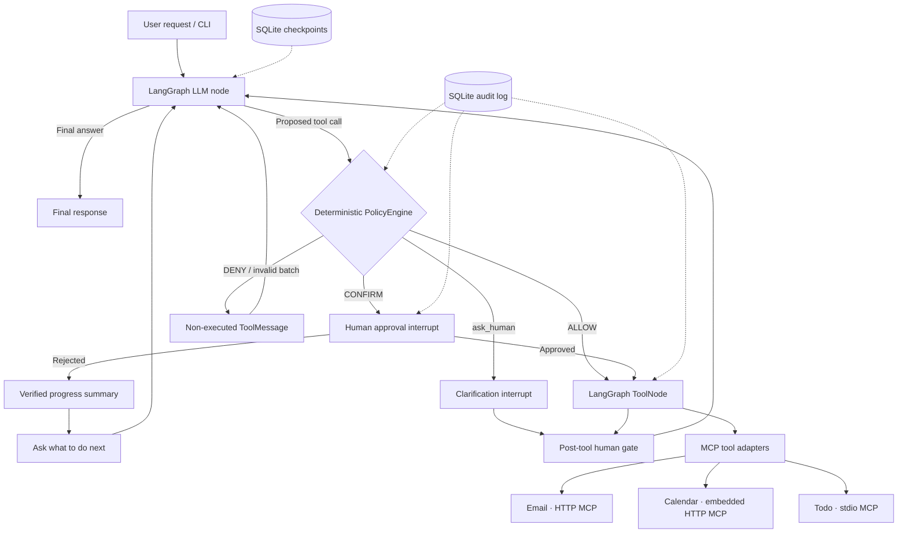

# MCP & AI Agent Training: the `Agent` branch

A LangGraph agent that works with real local applications through MCP. You can run it and dig into how it works: policy checks, human approval, persistent checkpoints, and an audit log you can inspect.

This branch of [MCP & AI Agent Training](https://github.com/Dreablin/MCP_Agent_Training) adds an agent on top of three working apps (Email, Todo, and Calendar). The agent discovers and calls their tools through the Model Context Protocol (MCP).

There's no polished chat UI here. The branch is about the engineering decisions that make a tool-using agent controllable, debuggable, and testable: where policy is enforced, how a paused workflow resumes, what happens on partial success, and how you find out what actually ran.

> **You're on the `Agent` branch.** If you want to build MCP yourself, start with [`main`](https://github.com/Dreablin/MCP_Agent_Training/tree/main). If you want to look at three integration patterns before the agent, go to [`MCP`](https://github.com/Dreablin/MCP_Agent_Training/tree/MCP). This branch has the reference agent.
>
> This is a local, single-user training environment, not a production assistant. No real email is delivered, and there's no authentication, cloud deployment, or multi-user isolation.

## Stages

| Stage | Branch | What's there |
| --- | --- | --- |
| 1. Apps | [`main`](https://github.com/Dreablin/MCP_Agent_Training/tree/main) | Email, Todo, and Calendar with no MCP and no agent |
| 2. MCP layer | [`MCP`](https://github.com/Dreablin/MCP_Agent_Training/tree/MCP) | Three reference MCP integrations: a separate HTTP service, an embedded HTTP endpoint, and a stdio child process |
| 3. Agent | [`Agent`](https://github.com/Dreablin/MCP_Agent_Training/tree/Agent) (this branch) | LangGraph orchestration, MCP clients, deterministic tool policy, human-in-the-loop, checkpoints, and audit |

## What's in this branch

| Concern | How it's done | Why |
| --- | --- | --- |
| Orchestration | LangGraph `StateGraph` with an LLM/tool loop | Control flow lives in the graph, not hidden inside one prompt |
| Tools | MCP clients wrapped as LangChain `StructuredTool` / `ToolNode` | The agent uses the apps' capabilities without importing their business logic |
| Mixed MCP transports | Streamable HTTP for Email and Calendar, stdio for Todo | One agent works with tools across different deployment boundaries |
| Deterministic decisions | `PolicyEngine` returns `ALLOW`, `CONFIRM`, or `DENY` | A separate layer decides whether a proposed tool call may run |
| Human-in-the-loop | LangGraph `interrupt()` and resume | Approval happens before a sensitive action, not after |
| Persistence | SQLite LangGraph checkpoints | An interrupted graph can resume in the same thread |
| Audit | Separate SQLite logs for events and tool calls | Decisions, results, interrupts, and state changes can be inspected |
| Tests | Scripted chat model and fake tools | Agent behavior gets regression tests without a real LLM |

The agent has the 16 MCP tools from the apps plus two local tools: `get_current_datetime` and `ask_human`.

## Architecture



The diagram is simplified. The code also has metadata initialization, a finalization node, and separate error and interrupt routing; the real state machine is in [`apps/agent_app/graph.py`](apps/agent_app/graph.py).

### How the agent connects to the apps

| App | MCP connection | Where the operation runs |
| --- | --- | --- |
| Email | Streamable HTTP, `http://127.0.0.1:8111/mcp` | Separate MCP service → Email REST API → Email app and database |
| Calendar | Streamable HTTP, `http://127.0.0.1:8013/mcp/` | MCP endpoint inside Calendar FastAPI → service layer and database |
| Todo | stdio subprocess managed by the client | Local MCP child process → Todo REST API → Todo app and database |

The agent never reads or writes the apps' databases directly. Its MCP registry keeps connections open for the CLI session, discovers each server's tools, and wraps each one as an async LangChain tool. Tool names are prefixed with the server name, for example `email_send_email`.

Real MCP tools here are async only. When integrating with the runtime, use the async run and resume paths (`arun` / `aresume`); the sync paths are for tests and sync tool implementations.

## Quick start

You need Python 3.12+, Git, Windows, macOS, or Linux, and either Ollama with a model that supports tool calling or an OpenAI API key. App data and the agent's databases stay local. No Docker or cloud.

### 1. Clone the branch

```bash
git clone --branch Agent https://github.com/Dreablin/MCP_Agent_Training.git
cd MCP_Agent_Training
```

### 2. Install dependencies

These commands install into the project's venv; you don't need to activate it.

Windows (Command Prompt):

```cmd
python -m venv .venv && .venv\Scripts\python.exe -m pip install -e ".[dev]"
```

macOS / Linux:

```bash
python3 -m venv .venv && .venv/bin/python -m pip install -e ".[dev]"
```

### 3. Configure a model

By default the agent uses local Ollama with these settings:

```dotenv
AGENT_LLM_PROVIDER=ollama
AGENT_LLM_MODEL=gemma4:31b
AGENT_OLLAMA_BASE_URL=http://127.0.0.1:11434
AGENT_LLM_TEMPERATURE=0.0
```

Ollama has to be running, and the model has to be available locally and support tool calling. You can set `AGENT_LLM_MODEL` to any other compatible model. The model isn't downloaded or started for you.

For OpenAI, create a `.env` from [`.env.example`](.env.example) and set:

```dotenv
AGENT_LLM_PROVIDER=openai
AGENT_LLM_MODEL=YOUR_TOOL_CALLING_MODEL
AGENT_OPENAI_API_KEY=YOUR_API_KEY
```

`.env` is optional and read from the repository root; without it, built-in defaults and environment variables are used. Don't commit `.env` or real keys.

### 4. Start the apps and MCP services

In a terminal at the repository root:

Windows (CMD):

```cmd
.venv\Scripts\python.exe -m scripts.run_all
```

macOS / Linux:

```bash
.venv/bin/python -m scripts.run_all
```

Keep this terminal open. It starts the Email app, the Email MCP server, the Todo app, and the Calendar app (which includes its MCP endpoint). Todo MCP isn't started by `run_all`: the agent launches it itself over stdio.

| Service | Address |
| --- | --- |
| Email web app | [http://127.0.0.1:8011](http://127.0.0.1:8011) |
| Email MCP | `http://127.0.0.1:8111/mcp` |
| Todo web app | [http://127.0.0.1:8012](http://127.0.0.1:8012) |
| Calendar web app | [http://127.0.0.1:8013](http://127.0.0.1:8013) |
| Calendar MCP | `http://127.0.0.1:8013/mcp/` |

The MCP addresses are protocol endpoints, not pages to open in a browser. Each app's REST API docs are at `/docs`. The app databases are created on first start.

### 5. Run the agent CLI

Open a second terminal in the same folder. Make sure the LLM server is running or the OpenAI key is set.

Windows (CMD):

```cmd
.venv\Scripts\python.exe -m apps.agent_app.cli
```

macOS / Linux:

```bash
.venv/bin/python -m apps.agent_app.cli
```

With the venv activated, you can also just run `agent-cli`.

Type requests in plain language. Session commands are `:help`, `:thread`, `exit`, and `quit`. The CLI streams LLM messages, tool calls, results, interrupts, and the final answer, and uses a single LangGraph thread for the whole session.

Some requests to try:

- "Find the oldest unread email and mark it as read."
- "Create a high-priority task to prepare for an architecture review."
- "What meetings do I have tomorrow?" (The agent gets the local date from `get_current_datetime`.)
- "Create a meeting and then a preparation task." (Several steps; think about what happens if one fails.)
- "Send a simulated email to alex@example.com with the subject 'Status update'." (Asks for human approval before sending.)

Not every model will handle all of these correctly. Email is simulated locally; nothing goes out.

Full per-platform instructions: [Windows](docs/run-instructions-windows.md), [macOS/Linux](docs/run-instructions-macos-linux.md), [general guide](docs/run-instructions.md).

## Safety: policy runs before MCP

The model can propose a tool call, but that doesn't mean the call is allowed to run. Deterministic code sits between the LLM and `ToolNode`.

### Current rules

| Situation | What happens |
| --- | --- |
| Model proposes `email_send_email` | **CONFIRM.** The graph pauses and shows the recipient, subject, and body before calling MCP |
| Human approves | The proposed call runs, and its result goes back to the LLM |
| Human rejects | **The MCP send call doesn't run.** The cancellation is recorded with `executed=false` and `retryable=false` |
| Model tries to send again in the same user request | **DENY**, with no second approval prompt. The restriction resets with the next user command |
| A batch contains any state-changing call | The whole batch is rejected, error tool messages are returned, and the model is asked to re-plan with one state-changing call at a time |
| A batch is read-only only | Several read-only calls are allowed |
| Any other known tool | Allowed by the current default policy. This is not a complete authorization model |

At the email approval prompt, the CLI takes `1` to approve and `2` to cancel. Any other input asks again; it's never treated as a yes or a no.

### After a rejection

The graph doesn't ask the LLM to retry right away. It moves to a summary of verified progress with tools turned off, then pauses again to ask the human what to do next. The answer becomes the next user message in the same graph context.

That keeps four things separate: what the model asked for, what policy allowed, what the user approved, and what a tool actually ran. You can add more policies; the current rules cover only a small set of risks on purpose.

Code: [`policy.py`](apps/agent_app/policy.py), [`graph.py`](apps/agent_app/graph.py), [`hitl.py`](apps/agent_app/hitl.py).

## Human-in-the-loop: approval and clarification are different

The agent pauses for two different reasons:

1. **Required approval.** Deterministic policy demands a human decision before a protected tool runs. The model can't skip this step.
2. **Clarification.** The LLM calls the local `ask_human` tool when a request is missing information or ambiguous, and continues after the user answers.

Both use LangGraph interrupts and checkpointed state, but one asks "may I do this?" and the other asks "what exactly should I do?".

There's also a `human_gate` node after tool execution. Right now it just passes through and is a hook for future extensions, not a separate approval policy.

## State, checkpoints, and audit

The message history holds regular `AIMessage`, `HumanMessage`, and `ToolMessage` objects, merged with the `add_messages` reducer. Tool errors go back to the LLM as error `ToolMessage`s, so the model can retry, fix the arguments, ask for clarification, or stop.

The CLI uses separate local SQLite files:

| File | Contents |
| --- | --- |
| `data/agent_checkpoints.db` | LangGraph checkpoints for pause and resume within a thread |
| `data/agent_debug.db` | Run metadata, graph events, tool call records, human interrupts, state snapshots |
| `data/email.db`, `data/todo.db`, `data/calendar.db` | The apps' own databases; the agent doesn't access them directly |

The audit schema has the tables `agent_runs`, `agent_events`, `tool_calls`, `human_interrupts`, and `state_snapshots`. They let you reproduce and explain failures and unexpected behavior instead of having only the final chat message to go on.

One caveat: the CLI uses SQLite checkpoints, but the LangGraph Studio entry point uses an in-memory checkpointer, even with the real runtime turned on. Studio's checkpoints don't survive a restart.

Code: [`audit.py`](apps/agent_app/audit.py), [`graph.py`](apps/agent_app/graph.py), [`studio.py`](apps/agent_app/studio.py).

## Testing control flow without an LLM

An important design decision is that the agent's control flow can be tested without live model responses. The tests use a scripted chat model and fake LangChain tools, run the real graph paths, and check the results.

From the repository root:

Windows (CMD):

```cmd
.venv\Scripts\python.exe -m pytest
```

macOS / Linux:

```bash
.venv/bin/python -m pytest
```

The tests cover approval before sending, rejection with nothing executed, no repeated approval in the same request, one state-changing action per batch, tool error handling, and audit events. They're a good base for your own adversarial tests.

`PolicyEngine` doesn't call an LLM or an MCP server, so you can test the policy on its own.

## LangGraph Studio (optional)

[`langgraph.json`](langgraph.json) exposes the graph through `apps.agent_app.studio:make_graph` so you can inspect it in LangGraph Studio.

By default, `AGENT_STUDIO_USE_REAL_RUNTIME=false` loads a fallback model and no MCP tools, so you can look at the graph without keys or running services. To load the real LLM and MCP registry:

```dotenv
AGENT_STUDIO_USE_REAL_RUNTIME=true
```

This needs a working model and all configured MCP services. Studio uses async-only real MCP tools and an in-memory checkpointer. Studio itself may need a separate install; the CLI and tests don't need it.

## Exercises

These are things to build. They aren't implemented yet.

| Exercise | Task |
| --- | --- |
| 1. Tighter write policy | Require confirmation for delete and move, show the exact target, don't ask again after a rejection |
| 2. Argument-based rules | Allow recipients from an allowlist; require approval for external domains |
| 3. Dry run | Show a multi-tool plan before any changes are made |
| 4. Ambiguity | Make "cancel my meeting with Alex" ask for clarification when several events match |
| 5. Partial failure | Create a meeting, then a task, then send a simulated notification; decide how to recover if step 3 fails |
| 6. Capability limits | Give the agent read-only calendar access while disabling email sending and task changes |
| 7. Adversarial prompts | Check whether untrusted email content can push the agent into unsafe tool calls |
| 8. Better audit explanations | Record which rule matched, which arguments mattered, and why an action was allowed or blocked |
| 9. Restart recovery | Check that interrupted approvals resume after a process restart; compare CLI SQLite and Studio in-memory behavior |
| 10. Repeatable evals | Compare policy violations, task completion, tool errors, latency, and user corrections across models |

One experiment worth trying: put malicious instructions inside a simulated incoming email, ask the agent to summarize it, and check whether it treats the email as untrusted data rather than as instructions to call tools. You'd have to implement and measure this yourself; the current prototype doesn't claim to be immune to prompt injection.

## Key files

| Path | Contents |
| --- | --- |
| [`apps/agent_app/graph.py`](apps/agent_app/graph.py) | LangGraph state machine, routing, policy and approval nodes, async execution |
| [`apps/agent_app/policy.py`](apps/agent_app/policy.py) | Deterministic `ALLOW / CONFIRM / DENY` decisions and approval payloads |
| [`apps/agent_app/mcp_registry.py`](apps/agent_app/mcp_registry.py) | MCP connections, tool discovery, LangChain tool adapters, registry lifecycle |
| [`apps/agent_app/local_tools.py`](apps/agent_app/local_tools.py) | Local clock tool and clarification tool registration |
| [`apps/agent_app/hitl.py`](apps/agent_app/hitl.py) | `ask_human` tool interface |
| [`apps/agent_app/audit.py`](apps/agent_app/audit.py) | SQLite audit tables and event recording |
| [`apps/agent_app/cli.py`](apps/agent_app/cli.py) | Interactive CLI, stream output, human input, resume |
| [`apps/agent_app/llm.py`](apps/agent_app/llm.py) | Ollama/OpenAI model factory |
| [`apps/agent_app/studio.py`](apps/agent_app/studio.py) | LangGraph Studio entry point |
| [`docs/architecture.md`](docs/architecture.md) | Detailed system and agent-layer design |
| [`docs/run-instructions.md`](docs/run-instructions.md) | Setup instructions and per-OS links |
| [`.env.example`](.env.example) | Local configuration reference |

## Limitations

The project is for local experiments and training:

- No real email delivery and no access to real mail, calendar, or task accounts.
- No authentication or multi-user permissions; the default policy allows most known tools.
- No production security guarantees: no sandbox, no certified prompt-injection defense, no complete authorization framework.
- No cloud deployment, service discovery, high availability, or distributed recovery.
- Correct behavior isn't guaranteed across models: tool-calling support, tool choice, and instruction following all vary.
- Models aren't downloaded automatically; you need to set up a compatible Ollama model or OpenAI access.

The point is a runnable environment where you can understand, challenge, measure, and improve all of the above.

## Documentation

- [Full architecture](docs/architecture.md)
- [Install and run](docs/run-instructions.md)
- [Windows setup](docs/run-instructions-windows.md)
- [macOS/Linux setup](docs/run-instructions-macos-linux.md)
- [Email REST API](docs/api-email.md)
- [Todo REST API](docs/api-todo.md)
- [Calendar REST API](docs/api-calendar.md)
- [License](LICENSE)

---

Start with the apps, add MCP, build the agent, then try to break it, and make its safety properties visible and testable.
