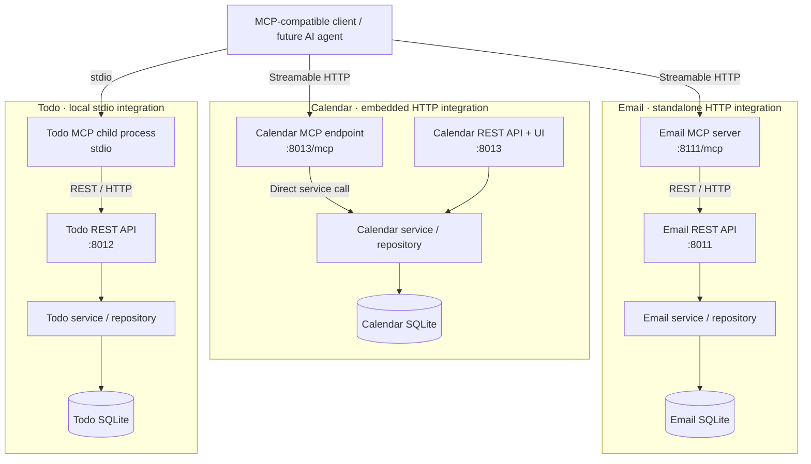

# MCP & AI Agent Training: the `MCP` branch

Three ways to plug MCP (Model Context Protocol) into existing applications, and what changes when the process boundary, transport, and data ownership differ.

This branch of [MCP & AI Agent Training](https://github.com/Dreablin/MCP_Agent_Training) adds working reference MCP implementations for three independent local apps: Email, Todo, and Calendar. Each app has a web UI, a REST API, a service layer, and its own SQLite database, so the MCP layer sits on top of real app boundaries rather than a few standalone functions. You can compare integration approaches without building the apps yourself or connecting any external accounts.

> **You're on the `MCP` branch.** [`main`](https://github.com/Dreablin/MCP_Agent_Training/tree/main) is the starting point for the exercises: the same apps with no MCP. [`Agent`](https://github.com/Dreablin/MCP_Agent_Training/tree/Agent) adds a reference AI agent that uses these MCP tools.

## Stages

| Stage | Branch | What you do |
| --- | --- | --- |
| 1. Build it yourself | [`main`](https://github.com/Dreablin/MCP_Agent_Training/tree/main) | Take the working Email, Todo, and Calendar apps and design the MCP layer yourself |
| 2. Compare MCP architectures | [`MCP`](https://github.com/Dreablin/MCP_Agent_Training/tree/MCP) (this branch) | Run three MCP integration patterns and look at their trade-offs |
| 3. Agent on top | [`Agent`](https://github.com/Dreablin/MCP_Agent_Training/tree/Agent) | LangGraph orchestration, policy checks, human approval, audit |

## What's in this branch

Each app is connected to MCP in its own way:

| App | Pattern | MCP transport | Access to business logic | Processes |
| --- | --- | --- | --- | --- |
| Email | Standalone MCP service | Streamable HTTP | Email REST API | MCP and the app are separate server processes |
| Calendar | MCP embedded in FastAPI | Streamable HTTP | Calendar service layer and shared session factory | MCP runs inside the app process |
| Todo | Local MCP server launched by the client | stdio / JSON-RPC | Todo REST API | MCP is a local child process |

These aren't three versions of the same setup competing with each other. They show different decisions about deployment, ownership, transport, coupling, and reuse of app logic.

### Architecture



The diagram leaves out the apps' NiceGUI interfaces. Calendar MCP and the Calendar API share one FastAPI process; Email MCP and Todo MCP reach their apps over REST.

## Running locally

You need Python 3.12+ and Git on Windows, macOS, or Linux. No Docker, cloud, LLM subscription, API key, or real mail or calendar accounts. All data is local.

### 1. Clone the branch

```bash
git clone --branch MCP https://github.com/Dreablin/MCP_Agent_Training.git
cd MCP_Agent_Training
```

### 2. Install and start

Windows (Command Prompt):

```cmd
python -m venv .venv && .venv\Scripts\python.exe -m pip install -e ".[dev]" && .venv\Scripts\python.exe -m scripts.run_all
```

macOS / Linux:

```bash
python3 -m venv .venv && .venv/bin/python -m pip install -e ".[dev]" && .venv/bin/python -m scripts.run_all
```

`run_all` starts the Email app, the Email MCP server, the Todo app, and the Calendar app. Calendar MCP starts inside the Calendar app. Todo MCP isn't part of `run_all`: the MCP client starts it when needed.

Databases are created on first run. Keep the terminal open; `Ctrl+C` stops everything.

Step-by-step setup: [Windows PowerShell](docs/run-instructions-windows.md), [macOS/Linux](docs/run-instructions-macos-linux.md).

### 3. Open the apps or connect an MCP client

| Component | Address | How to use |
| --- | --- | --- |
| Email app | [http://127.0.0.1:8011](http://127.0.0.1:8011) | Web UI; REST API docs at `/docs` |
| Email MCP | `http://127.0.0.1:8111/mcp` | MCP client over Streamable HTTP |
| Todo app | [http://127.0.0.1:8012](http://127.0.0.1:8012) | Web UI; REST API docs at `/docs` |
| Todo MCP | No HTTP address | The MCP client launches a local stdio process |
| Calendar app | [http://127.0.0.1:8013](http://127.0.0.1:8013) | Web UI; REST API docs at `/docs` |
| Calendar MCP | `http://127.0.0.1:8013/mcp` | MCP client over Streamable HTTP |

The `/mcp` addresses are protocol endpoints, not web pages: you need an MCP client to see and call the tools. The `/docs` pages describe the apps' REST APIs, not MCP.

For Todo MCP, configure your client to run this module from the repository root, using the project's venv Python:

```bash
python -m apps.todo_MCP.main
```

The Todo app has to be running at `http://127.0.0.1:8012`, otherwise the tools can't reach its REST API. A stdio server talks over stdin/stdout, so starting it in a terminal won't give you anything to open in a browser.

## MCP tools

The three servers register 16 tools in total. The lists below are what's actually implemented, not a roadmap.

### Email MCP: 5 tools

Source: [`apps/email_MCP/tools.py`](apps/email_MCP/tools.py)

| Tool | What it does | Effect |
| --- | --- | --- |
| `list_email_folders` | Lists mailbox folders | Read only |
| `get_oldest_unread_email` | Returns the oldest unread message | Read only |
| `mark_email_read` | Marks a message as read by ID | Changes message state |
| `move_email_to_folder` | Moves a message to another folder | Changes message state |
| `send_email` | Creates a simulated sent message | Changes local state; no real email is sent |

Email MCP calls the Email REST API through `httpx` and never opens the Email SQLite database directly.

### Todo MCP: 4 tools

Source: [`apps/todo_MCP/tools.py`](apps/todo_MCP/tools.py)

| Tool | What it does | Effect |
| --- | --- | --- |
| `list_todo_tasks` | Lists tasks, optionally filtered by status and priority | Read only |
| `create_todo_task` | Creates a task | Changes state |
| `cancel_todo_task` | Cancels a task | Changes state |
| `complete_todo_task` | Completes a task | Changes state |

Todo MCP goes through the Todo REST API, not the database. The client manages the stdio process's lifecycle; the Todo app owns the business logic and storage.

### Calendar MCP: 7 tools

Source: [`apps/calendar_app/mcp_tools.py`](apps/calendar_app/mcp_tools.py)

| Tool | What it does | Effect |
| --- | --- | --- |
| `list_calendar_events` | Lists events that overlap a time window | Read only |
| `search_calendar_events` | Searches events by text | Read only |
| `create_calendar_event` | Creates an event | Changes state |
| `update_calendar_event` | Edits an event | Changes state |
| `cancel_calendar_event` | Cancels an event | Changes state |
| `restore_calendar_event` | Restores a cancelled event | Changes state |
| `delete_calendar_event` | Deletes an event permanently | Destructive |

Calendar tools call the same services as the Calendar UI and REST API. Each call opens a short-lived SQLAlchemy session; sessions aren't kept between MCP calls. Changes go through the app's command runner.

Watch the times. Calendar stores local times with no timezone on purpose (for example, `2026-08-27T15:00:00`), while Email and Todo use timezone-aware timestamps. Read [Architecture](docs/architecture.md) before building scheduling across apps.

## The three architectures in detail

### 1. Email: a separate MCP service over Streamable HTTP

```text
MCP client → Email MCP process → HTTP REST API → Email service → SQLite
```

The Email MCP server deliberately lives outside the app process. It can be developed and deployed separately and reaches the app only through REST.

Pros:

- MCP code doesn't depend on the app's internals.
- It reuses the existing API contract instead of duplicating business logic.
- It's how you'd integrate with an app you can't modify.

Cons:

- Needs a separate process and a working app API.
- Adds an HTTP hop, error handling, and network failures.
- The REST contract and the MCP tool contract may have to change together.

Code: [`apps/email_MCP/server.py`](apps/email_MCP/server.py), [`apps/email_MCP/tools.py`](apps/email_MCP/tools.py).

### 2. Calendar: MCP inside an existing FastAPI app

```text
MCP client → /mcp inside Calendar FastAPI → Calendar service → SQLite
```

The Calendar app mounts an MCP ASGI app at `/mcp` and starts the MCP session manager in its FastAPI lifespan. MCP, REST, and UI share the same services, and there's no HTTP call back into the same backend.

Pros:

- Uses domain services directly, with no extra HTTP calls.
- One process and one deployment unit.
- The UI, REST API, and MCP tools all follow the same business rules.

Cons:

- MCP is more tightly tied to the backend code and its lifecycle.
- Sessions, transactions, and exceptions need careful handling.
- MCP and the app are released together.

Each tool call creates its own short-lived service and session scope. **Don't keep a SQLAlchemy `Session` alive between MCP calls.**

Code: [`apps/calendar_app/main.py`](apps/calendar_app/main.py), [`apps/calendar_app/mcp_server.py`](apps/calendar_app/mcp_server.py), [`apps/calendar_app/mcp_tools.py`](apps/calendar_app/mcp_tools.py).

### 3. Todo: an MCP subprocess over stdio, managed by the client

```text
MCP client → local stdio MCP subprocess → HTTP REST API → Todo service → SQLite
```

The Todo MCP server is a local child process, not an HTTP service. MCP messages go over stdin/stdout, but the actual work still goes through the Todo REST API.

Pros:

- No separate port for MCP.
- Works well with desktop clients and local development.
- Business rules and transactions stay with the Todo app.

Cons:

- The client has to start and stop the MCP process.
- The Python interpreter and working directory must be set up correctly.
- The Todo app still has to be reachable through its local REST API.

Note that stdio is only the MCP transport. Todo MCP talks to the Todo app over HTTP.

Code: [`apps/todo_MCP/main.py`](apps/todo_MCP/main.py), [`apps/todo_MCP/tools.py`](apps/todo_MCP/tools.py).

## Side-by-side comparison

| Question | Separate HTTP (Email) | Embedded HTTP (Calendar) | Local stdio (Todo) |
| --- | --- | --- | --- |
| Who starts MCP? | A separate launcher | The Calendar app | The MCP client |
| Network endpoint? | Yes | Yes, inside the app | No |
| How does it reach domain logic? | REST API | Service layer | REST API |
| Can MCP and the app be separate processes? | Yes | No, by design | Yes |
| Extra HTTP hop to the logic? | Yes | No | Yes |
| When to choose it | Integrating an existing service with an API | Extending a backend you own | Local tool integration |

None of them is best in every case. The choice depends on who owns the processes, how complex operations get, whether you can change the app, and which trust boundary you need to keep.

## Exercises

### A. Build an MCP layer from scratch

Start from [`main`](https://github.com/Dreablin/MCP_Agent_Training/tree/main) and write your own MCP implementation before you read the code in this branch. Decide which tools to expose, how to validate input, and whether each integration should call REST or the service layer.

Done when an MCP client can see and call your tools, and the apps still work on their own.

### B. Compare the three designs

Run the implementations in this branch and explain why each one reaches its app's logic differently. Compare coupling, how errors propagate, deployment, and who owns the database.

Done when you've written down, for each pattern, one scenario where you'd choose it and one reason you'd reject it.

### C. Extend a tool safely

Add a narrowly scoped operation to one of the servers. Write a clear description and argument schema, use the app's validation rules, and return a useful error on failure. Test it without an LLM.

Done when your code tells apart a malformed request, a missing record, an app conflict, and a backend outage.

### D. Move on to an agent

Use these MCP integrations as the agent's tool layer. Try a cross-app task: find a meeting request, check the calendar, create a task in Todo. Then figure out where approvals, retries, and audit logs belong.

The [`Agent`](https://github.com/Dreablin/MCP_Agent_Training/tree/Agent) branch has a reference implementation of agent orchestration and safety controls.

## Practical notes

- **Tool metadata isn't access control.** MCP annotations like `readOnlyHint`, `destructiveHint`, and `idempotentHint` describe intended behavior; they don't enforce permissions or a safety policy.
- **Keep data with the apps.** Email and Todo MCP servers shouldn't bypass REST and write to the apps' databases.
- **Plan for partial failure.** An operation that makes several requests can fail after the first ones succeeded. Think about retries and idempotency before using similar patterns in production.
- **Tool output is data.** Untrusted email content must not turn into instructions for a future AI agent.
- **Calendar times are different.** Don't silently convert naive Calendar times to UTC or guess their timezone.
- **There's no production security boundary.** The local example has no authentication, multi-tenant authorization, external secrets management, or hardened deployment config.

## Tests and data

Install the dev dependencies, activate the venv, and run the tests from the repository root:

```bash
python -m pytest
```

To add demo data:

```bash
python -m scripts.seed_demo_data
```

To reset data, stop the apps first, then run:

```bash
python -m scripts.reset_data
```

**This deletes the SQLite files in `data/`.** The apps recreate the databases on next start.

## Project map

| Path | Contents |
| --- | --- |
| [`apps/email_MCP/`](apps/email_MCP/) | Standalone Email MCP server and its REST-backed tools |
| [`apps/todo_MCP/`](apps/todo_MCP/) | Todo stdio MCP server and its REST-backed tools |
| [`apps/calendar_app/mcp_server.py`](apps/calendar_app/mcp_server.py) | Builds the embedded Calendar MCP server |
| [`apps/calendar_app/mcp_tools.py`](apps/calendar_app/mcp_tools.py) | Calendar MCP tools and their service integration |
| [`apps/email_app/`](apps/email_app/) | Email app: UI, REST API, data model |
| [`apps/todo_app/`](apps/todo_app/) | Todo app: UI, REST API, data model |
| [`apps/calendar_app/`](apps/calendar_app/) | Calendar app: UI, REST API, data model |
| [`shared/`](shared/) | Shared technical utilities (no cross-app business logic) |
| [`scripts/`](scripts/) | Run, seed, stop, and reset scripts |
| [`docs/`](docs/) | Architecture, APIs, and per-platform setup |

## Documentation

- [Architecture and boundaries](docs/architecture.md)
- [Run instructions overview](docs/run-instructions.md)
- [Windows PowerShell setup](docs/run-instructions-windows.md)
- [macOS / Linux setup](docs/run-instructions-macos-linux.md)
- [Email REST API](docs/api-email.md)
- [Todo REST API](docs/api-todo.md)
- [Calendar REST API](docs/api-calendar.md)
- [Database schema](docs/database-schema.md)

## Limitations

This is a local training reference, not a deployable mail, calendar, or productivity platform. The `MCP` branch has no LLM and no autonomous agent. The apps don't send real email, connect to external accounts, authenticate users, support multiple users, or include production deployment infrastructure.

The point is to make MCP integration decisions something you can see, run, and compare.

---

[`main`: start from scratch](https://github.com/Dreablin/MCP_Agent_Training/tree/main) · [`MCP`: study the integrations](https://github.com/Dreablin/MCP_Agent_Training/tree/MCP) · [`Agent`: build and secure an agent](https://github.com/Dreablin/MCP_Agent_Training/tree/Agent)
